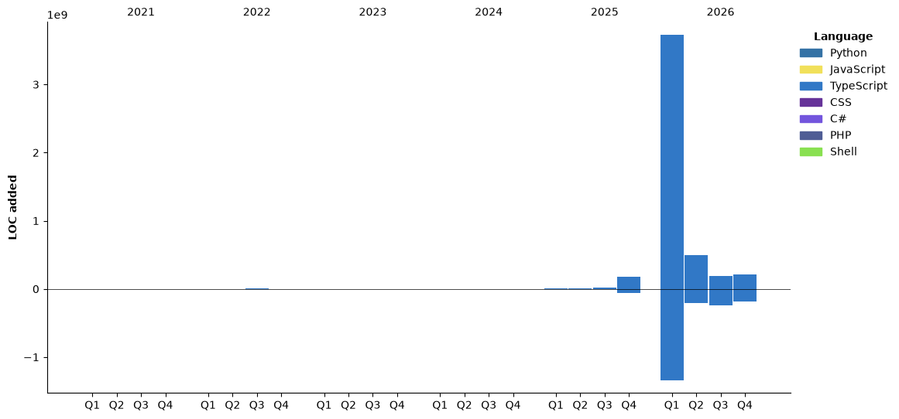

<!--START_SECTION:waka-->


**🐱 My GitHub Data** 

> 📦 129.3 kB Used in GitHub's Storage 
 > 
> 🏆 6,544 Contributions in the Year 2026
 > 
> 🚫 Not Opted to Hire
 > 
> 📜 10 Public Repositories 
 > 
> 🔑 18 Private Repositories 
 > 
**I'm an Early 🐤** 

```text
🌞 Morning                299760 commits      █████████░░░░░░░░░░░░░░░░   36.46 % 
🌆 Daytime                470873 commits      ██████████████░░░░░░░░░░░   57.27 % 
🌃 Evening                50635 commits       ██░░░░░░░░░░░░░░░░░░░░░░░   06.16 % 
🌙 Night                  913 commits         ░░░░░░░░░░░░░░░░░░░░░░░░░   00.11 % 
```
📅 **I'm Most Productive on Monday** 

```text
Monday                   187494 commits      ██████░░░░░░░░░░░░░░░░░░░   22.80 % 
Tuesday                  181278 commits      ██████░░░░░░░░░░░░░░░░░░░   22.05 % 
Wednesday                171478 commits      █████░░░░░░░░░░░░░░░░░░░░   20.86 % 
Thursday                 134681 commits      ████░░░░░░░░░░░░░░░░░░░░░   16.38 % 
Friday                   126547 commits      ████░░░░░░░░░░░░░░░░░░░░░   15.39 % 
Saturday                 14052 commits       ░░░░░░░░░░░░░░░░░░░░░░░░░   01.71 % 
Sunday                   6651 commits        ░░░░░░░░░░░░░░░░░░░░░░░░░   00.81 % 
```


📊 **This Week I Spent My Time On** 

```text
🕑︎ Time Zone: Europe/Amsterdam

💬 Programming Languages: 
No Activity Tracked This Week

🔥 Editors: 
No Activity Tracked This Week

🐱‍💻 Projects: 
No Activity Tracked This Week

💻 Operating System: 
No Activity Tracked This Week
```

🤖 **AI Coding This Week** 

```text
No AI Coding Activity Tracked This Week
```

**I Mostly Code in TypeScript** 

```text
TypeScript               32 repos            ███████████████░░░░░░░░░░   61.54 % 
JavaScript               7 repos             ███░░░░░░░░░░░░░░░░░░░░░░   13.46 % 
Python                   4 repos             ██░░░░░░░░░░░░░░░░░░░░░░░   07.69 % 
CSS                      2 repos             █░░░░░░░░░░░░░░░░░░░░░░░░   03.85 % 
Shell                    1 repo              ░░░░░░░░░░░░░░░░░░░░░░░░░   01.92 % 
```


**Timeline**




 Last Updated on 22/11/2026 02:04:47 UTC
<!--END_SECTION:waka-->
